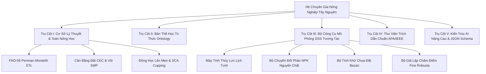
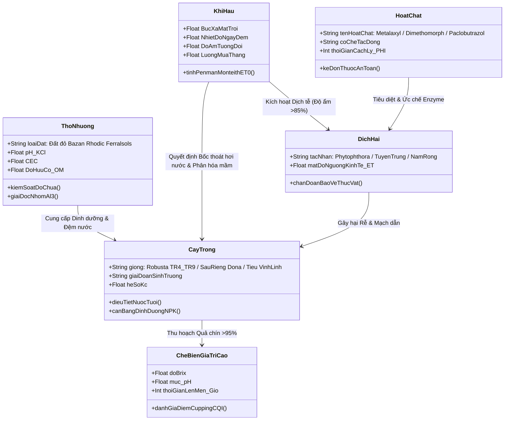
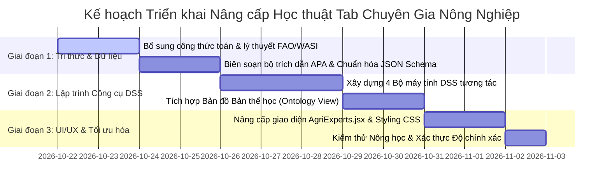

# BÁO CÁO ĐÁNH GIÁ CHUYÊN GIA & KẾ HOẠCH NÂNG CẤP HỌC THUẬT
## TAB "HỆ CHUYÊN GIA NÔNG NGHIỆP" (PRECISION AGRI-DSS HUB)

---

**Cơ quan / Hội đồng chuyên gia thẩm định:**  
*Hội đồng Chuyên gia Liên ngành Nông nghiệp Chính xác & Trí tuệ Nhân tạo Ứng dụng*  
*Đại diện chuyên môn: Nông học & Thổ nhưỡng Tây Nguyên (WASI / ĐH Nông Lâm) & Chuyên gia Kiến trúc Hệ thống DSS / Multi-Agent AI*  
**Thời gian lập báo cáo:** Tháng 10/2026  
**Mã hồ sơ lưu trữ:** `depPlan/bao_cao_chuyen_gia_va_de_xuat_nang_cap_tab_chuyen_gia_nong_nghiep.md`

---

## MỤC LỤC
1. [TỔNG QUAN & TÔN CHỈ ĐÁNH GIÁ](#1-tổng-quan--tôn-chỉ-đánh-giá)
2. [ĐÁNH GIÁ HIỆN TRẠNG TAB "CHUYÊN GIA NÔNG NGHIỆP"](#2-đánh-giá-hiện-trạng-tab-chuyên-gia-nông-nghiệp)
   - 2.1. Điểm mạnh và giá trị đột phá đã thiết lập
   - 2.2. Nhận diện các khoảng trống học thuật (Academic & Technical Gap Analysis)
3. [ĐỀ XUẤT NÂNG CẤP THEO 5 TRỤ CỘT HỌC THUẬT CHUYÊN SÂU](#3-đề-xuất-nâng-cấp-theo-5-trụ-cột-học-thuật-chuyên-sâu)
   - 3.1. Trụ cột I: Cơ sở Lý thuyết & Mô hình Toán học Sinh lý - Thổ nhưỡng Định lượng
   - 3.2. Trụ cột II: Bản đồ Bản thể học Nông nghiệp (Agri-Domain Ontology & Knowledge Graph)
   - 3.3. Trụ cột III: Bộ Công cụ Mô phỏng & Tính toán Nông học Tương tác (Interactive DSS Calculators)
   - 3.4. Trụ cột IV: Danh mục Trích dẫn Khoa học & Khung Pháp chuẩn (Academic Citations & Standards)
   - 3.5. Trụ cột V: Nâng cấp Kiến trúc AI (Advanced Agentic Workflow & Structured Output Contracts)
4. [KẾ HOẠCH TRIỂN KHAI CHI TIẾT (ACTIONABLE IMPLEMENTATION ROADMAP)](#4-kế-hoạch-triển-khai-chi-tiết-actionable-implementation-roadmap)
   - Phase 1: Mở rộng Dữ liệu Khoa học Nền tảng (`expertSystemsData.js`)
   - Phase 2: Lập trình Bộ Công cụ Tính toán Tương tác trong `AgriExperts.jsx`
   - Phase 3: Hoàn thiện Giao diện, Biểu đồ Radar/Ontology & Thư viện Trích dẫn
   - Phase 4: Thẩm định Độ chính xác Nông học & Kiểm thử Tích hợp
5. [KẾT LUẬN & KIẾN NGHỊ HỘI ĐỒNG](#5-kết-luận--kiến-nghị-hội-đồng)

---

## 1. TỔNG QUAN & TÔN CHỈ ĐÁNH GIÁ

Nông nghiệp vùng Tây Nguyên (Đắk Lắk, Gia Lai, Lâm Đồng, Đắk Nông, Kon Tum) là vùng kinh tế trọng điểm quốc gia về cây công nghiệp dài ngày (Cà phê Robusta, Hồ tiêu), cây ăn trái xuất khẩu tỷ đô (Sầu riêng), trên nền tảng thổ nhưỡng đất đỏ Bazan (Rhodic Ferralsols) vô cùng nhạy cảm.

Việc chuyển dịch từ **Mô hình Thị giác Máy tính đơn thuần (Computer Vision)** sang **Hệ Chuyên Gia Hỗ Trợ Quyết Định (Decision Support System - DSS)** là một bước tiến mang tính cách mạng trong chương trình giảng dạy và ứng dụng AI thực tế. 

Tuy nhiên, để tab **"Chuyên gia nông nghiệp"** không dừng lại ở mức độ là một "Bộ sưu tập System Prompts", mà thực sự trở thành một **Trung tâm Nghiên cứu & Ra quyết định Nông nghiệp Số (Academic Precision Agri-DSS Hub)** đạt chuẩn kiểm định đại học và chuyển giao công nghệ cho các kỹ sư nông học, giảng viên, nghiên cứu sinh và doanh nghiệp, hệ thống cần được nâng tầm cả về **chiều sâu toán học nông nghiệp**, **cơ chế thực nghiệm tương tác** và **tính chuẩn mực khoa học**.

---

## 2. ĐÁNH GIÁ HIỆN TRẠNG TAB "CHUYÊN GIA NÔNG NGHIỆP"

### 2.1. Điểm mạnh và giá trị đột phá đã thiết lập
1. **Tư duy Kiến trúc Đa đại lý (Multi-Agent Architecture):** Đã phân định rõ vai trò giữa *Meta-Agent Orchestrator* (Chỉ huy) và các *Sub-Agents chuyên trách* (Khí hậu, Sinh lý, Bệnh học, Dược lý, Vi sinh, Q-Grader).
2. **Kỷ luật Thực thi Siêu nghiêm ngặt (4 Luật Bất Biến):** Tiếp thu xuất sắc từ tư duy kiểm soát thủ tục tư pháp (Sentinel Protocol v17) với *Atomic Execution*, *Data Injection*, *State Lock*, và *Confidence Metric*.
3. **Cơ chế Tri thức Đảm bảo (Source Grounding via NotebookLM):** Đặt nền tảng tri thức vào các tài liệu chuyên ngành của WASI, TCVN, SCA thay vì để LLM trả lời cảm tính (Anti-Hallucination).
4. **Quy trình 5 Cửa Sắt & Kịch bản Red Team:** Đã xây dựng sẵn các mốc chốt chặn kỹ thuật và tình huống phản biện rủi ro (mưa trái mùa, sốc đọt, ngộ độc phân).

### 2.2. Nhận diện các khoảng trống học thuật (Academic & Technical Gap Analysis)

| # | Khía cạnh | Hiện trạng | Khoảng trống học thuật cần bổ sung |
| :--- | :--- | :--- | :--- |
| **1** | **Mô hình Toán & Định lượng** | Hướng dẫn định lượng bằng lời văn (VD: tưới 400L/gốc, bón 250g NPK). | Thiếu các **phương trình cân bằng sinh thái chuẩn hóa**: Phương trình Penman-Monteith (FAO-56) tính bốc thoát hơi nước ($ET_0, ET_c$), mô hình cân bằng Cation đất ($CEC, BS\%$), phương trình Shoemaker-McLean-Pratt (SMP) tính lượng vôi khử chua, phương trình động lực học dịch hại Logistic/Gompertz. |
| **2** | **Tính Tương tác Số (Interactivity)** | Người dùng đọc prompt và sao chép sang nền tảng bên ngoài (ChatGPT / Gemini / NotebookLM). | Người học/Kỹ sư **chưa thể tự tay đưa tham số vườn vào để máy tính chạy mô phỏng trực tiếp trên web** (VD: Nhập $pH_{KCl}$, diện tích, độ sâu tầng đất để ra ngay biểu đồ liều lượng vôi và thời gian phục hồi). |
| **3** | **Bản thể học Tri thức (Ontology)** | Liệt kê các danh mục kiến thức dạng gạch đầu dòng. | Thiếu **Bản đồ Tri thức (Agri-Knowledge Graph)** biểu diễn mối tương quan đa chiều giữa: *Cây trồng $\rightarrow$ Giai đoạn hình thái $\rightarrow$ Điều kiện vi khí hậu $\rightarrow$ Tác nhân nấm/khuẩn $\rightarrow$ Cơ chế hoạt chất $\rightarrow$ Tác động sinh thái*. |
| **4** | **Chuẩn mực Trích dẫn Khoa học** | Liệt kê tên sách dạng khái quát ("Sách WASI", "TCVN"). | Thiếu **Danh mục Tài liệu Tham khảo chuẩn APA/IEEE** với mã hiệu tiêu chuẩn, tác giả, năm xuất bản, tổ chức phát hành và chỉ số DOI/ISBN để sinh viên trích dẫn vào khóa luận tốt nghiệp. |
| **5** | **Đầu ra Dữ liệu Có cấu trúc** | Đầu ra LLM dạng văn bản Markdown tự do. | Thiếu đặc tả **JSON Schema / Pydantic Data Contract** cho phép hệ thống xuất báo cáo kê đơn nông nghiệp kết nối thẳng vào hệ thống IoT tưới tự động hoặc phần mềm quản lý nông trại (ERP). |

---

## 3. ĐỀ XUẤT NÂNG CẤP THEO 5 TRỤ CỘT HỌC THUẬT CHUYÊN SÂU



---

### 3.1. Trụ cột I: Cơ sở Lý thuyết & Mô hình Toán học Sinh lý - Thổ nhưỡng Định lượng

Để đảm bảo tính hàn lâm, bổ sung trực tiếp các chuyên đề toán nông học vào từng hệ chuyên gia:

#### 1. Hệ Cà phê Robusta (`COFFEE-MASTER v1`):
* **Mô hình bốc thoát hơi nước FAO-56 Penman-Monteith:**
  $$ET_c = K_c \times ET_0$$
  * $ET_0$: Bốc thoát hơi nước tham chiếu (tính từ bức xạ mặt trời, nhiệt độ, độ ẩm, tốc độ gió tại trạm khí tượng Buôn Ma Thuột / Pleiku).
  * $K_c$: Hệ số cây trồng cà phê Robusta qua các thời kỳ:
    * Giai đoạn phân hóa mầm hoa (tháng 12 - 01): $K_c = 0.80 - 0.85$ (giai đoạn xiết nước).
    * Giai đoạn tưới bung hoa đợt 1 (tháng 01 - 02): $K_c = 1.05 - 1.10$.
    * Giai đoạn quả non lớn nhanh (mùa mưa tháng 05 - 08): $K_c = 1.15 - 1.20$.
* **Công thức xác định lượng nước tưới hữu hiệu ($RAW$ - Readily Available Water):**
  $$RAW = p \times TAW = p \times \frac{(\theta_{FC} - \theta_{WP})}{100} \times Z_r \times \rho_b$$
  * $\theta_{FC}$: Độ ẩm đất ở sức chứa ẩm đồng ruộng (Field Capacity, đất bazan $\approx 36 - 38\%$).
  * $\theta_{WP}$: Độ ẩm cây héo vĩnh viễn (Wilting Point, đất bazan $\approx 24 - 26\%$).
  * $p$: Hệ số suy giảm lượng nước hữu dụng không gây stress ($p \approx 0.5 - 0.6$).
  * $Z_r$: Chiều sâu tầng rễ hữu hiệu của cà phê kinh doanh ($0.6 - 0.8\text{ m}$).
  * **Định mức tưới chuẩn:** Tính ra $380 - 420\text{ lít/cây/lần tưới}$ với chu kỳ $22 - 25\text{ ngày}$.

#### 2. Hệ Bảo vệ Thực vật Hồ tiêu (`PEPPER-DOCTOR v1`):
* **Mô hình Dịch tễ học Động lực Quần thể (*Phytophthora capsici* & Tuyến trùng):**
  * Tốc độ lây lan của nấm nọc bào tử động (*zoospore*) qua dòng nước mặt: $v = f(\text{Độ ẩm đất} > 85\%, \text{Nhiệt độ} \in [24^\circ\text{C}, 28^\circ\text{C}])$.
  * Ngưỡng can thiệp kinh tế (Economic Threshold - ET):
    * Mật độ tuyến trùng (*Meloidogyne incognita*): $> 50\text{ con/100g rễ}$ hoặc $> 100\text{ con/100g đất}$.
    * Chỉ số tổn thương mạch dẫn rễ (Galling Index) theo thang Taylor & Sasser $> 3$.
* **Cơ chế Dược động học Hoạt chất BVTV:**
  * Hoạt chất trừ nấm Metalaxyl / Mefenoxam: Tác động ức chế enzyme RNA Polymerase I của nấm Oomycetes, cơ chế lưu dẫn hướng ngọn (acropetal).
  * Hoạt chất Dimethomorph: Ức chế tổng hợp thành tế bào (phospholipid biosynthesis) giai đoạn nảy mầm của bào tử.

#### 3. Hệ Sinh lý & Kỹ thuật Sầu riêng (`DURIAN-MASTER v1`):
* **Cân bằng Sinh hóa Phân hóa Mầm Hoa:**
  * Tỷ số Carbohydrate / Nitrogen trong lá ($C/N$ Ratio): Yêu cầu $C/N > 15$ tại giai đoạn 45 ngày trước khi tạo mắt cua.
  * Ức chế Gibberellin nội sinh ($GA_3$): Phun Paclobutrazol liều lượng $1000 - 1500\text{ ppm}$ để kìm hãm sinh trưởng sinh dưỡng, thúc đẩy tổng hợp Cytokinin và Abscisic Acid ($ABA$) tại mắt cua.
* **Cơ chế Sinh lý Rụng Trái Non:**
  * Tầng rời (*Abscission Zone*) hình thành tại cuống hoa do ưu thế ngọn của cơi đọt mới hút dinh dưỡng đa vi lượng (Canxi, Bo) làm nứt tế bào mô đệm cuống hoa.
  * Giải pháp hóa sinh: Phun Canxi Bo chelate hữu cơ kết hợp hoạt chất chặn đọt Mepiquat Chloride hoặc Phosphonate kali ($K_2HPO_3$) nồng độ $0.2 - 0.3\%$ để cố định đọt mà không gây cháy lá già.

#### 4. Hệ Cải tạo Đất đỏ Bazan (`SOIL-MASTER v1`):
* **Cân bằng Cation Trao đổi (Base Saturation & Cation Ratio):**
  * Dung tích hấp thu Cation ($CEC$): Đất đỏ bazan Tây Nguyên thường dao động $12 - 20\text{ cmol(+)/kg}$.
  * Tỷ lệ tối ưu theo học thuyết Kinsey-Albrecht: $Ca^{2+} (65 - 75\%)$, $Mg^{2+} (10 - 15\%)$, $K^+ (3 - 5\%)$.
* **Phương trình Tính toán Lượng Vôi Khử Chua & Trung hòa Nhôm tự do ($Al^{3+}$):**
  $$\text{Lượng vôi } CaCO_3\text{ (tấn/ha)} = 1.5 \times Al^{3+}\text{ trao đổi [cmol(+)/kg]} \times \text{Hệ số đệm thổ nhưỡng (1.25)}$$
  * Khi $pH_{KCl} < 4.2$, độc tính nhôm $Al^{3+}$ tăng theo cấp số nhân, kết tủa với ion phosphat ($H_2PO_4^-$) tạo thành $AlPO_4$ không tan (hiện tượng cố định lân). Cần chia nhỏ liều bón vôi $1.5 - 2.0\text{ tấn/ha/năm}$, kết hợp lân nung chảy Văn Điển/Ninh Bình ($Ca_3(PO_4)_2$ kiềm tính) để nâng pH đệm từ từ.

#### 5. Hệ Chế biến sâu Fine Robusta (`BREW-MASTER v1`):
* **Động học Lên men Yếm khí (Anaerobic Fermentation Kinetics):**
  * Quá trình đường phân (Glycolysis) chuyển hóa saccharose, glucose và fructose thành Acid Lactic và Acid Acetic bởi vi khuẩn *Lactobacillus* và nấm men *Saccharomyces cerevisiae*.
  * Kiểm soát điểm dừng lên men (Fermentation Cutoff Criteria):
    $$\text{Độ Brix ban đầu } (21 - 24^\circ\text{Bx}) \xrightarrow{\text{Yếm khí 72 - 96h}} \text{Brix cuối } (12 - 14^\circ\text{Bx}), \quad pH \text{ giảm từ } 5.8 \rightarrow [3.9 - 4.1]$$
    *Nếu $pH < 3.8$: Nguy cơ hỏng mẻ do vi khuẩn sinh acid butyric (mùi thối hữu cơ).*
* **Thang điểm CQI Fine Robusta (Coffee Quality Institute Cupping Protocol):**
  * 10 tiêu chí đánh giá trên thang 100 điểm: Fragrance/Aroma, Flavor, Aftertaste, Salt/Acid Aspect, Bitter/Sweet Aspect, Mouthfeel, Balance, Clean Cup, Uniformity, Overall.
  * Phân loại: Fine Robusta (>= 80 điểm, không lỗi sơ cấp Category 1 Defect).

---

### 3.2. Trụ cột II: Bản đồ Bản thể học Nông nghiệp (Agri-Domain Ontology & Knowledge Graph)

Bổ sung một sơ đồ phân cấp trực quan và tương tác thể hiện cấu trúc tri thức nông học liên ngành, kết nối các thực thể:



---

### 3.3. Trụ cột III: Bộ Công cụ Mô phỏng & Tính toán Nông học Tương tác (Interactive DSS Calculators)

Tích hợp trực tiếp 4 máy tính mô phỏng tương tác trên giao diện để sinh viên, kỹ sư và người học nhập tham số thực tế và nhận kết quả tức thì:

#### 1. Bộ tính Thủy lực & Lịch tưới Cà phê Penman-Monteith (FAO-56):
* **Inputs:** Số lượng cây/ha, Tuổi cây, Loại đất (Bazan dày/mỏng), Nhiệt độ trung bình ngày, Tốc độ gió, Độ ẩm không khí, Số ngày từ lần tưới trước.
* **Outputs:** Giá trị $ET_0$ (mm/ngày), $ET_c$ (mm/ngày), Lượng nước bốc thoát tích lũy (lít/gốc), Dự báo ngày cần tưới đợt tiếp theo, Lượng nước tưới tối ưu (lít/gốc) để tiết kiệm 20% nước ngầm.

#### 2. Bộ chuyển đổi Dinh dưỡng N-P-K Nguyên chất $\leftrightarrow$ Phân bón Thương phẩm:
* **Inputs:** Nhu cầu dinh dưỡng khuyến cáo của WASI theo giai đoạn sinh trưởng (VD: Đậu trái non: $N: 120\text{ kg}, P_2O_5: 60\text{ kg}, K_2O: 140\text{ kg/ha}$).
* **Outputs:** Khối lượng phân bón đơn cụ thể cần mua: Urê ($46\% N$), Lân nung chảy ($16\% P_2O_5$), Kali Clorua ($60\% K_2O$) hoặc các công thức NPK hỗn hợp thương phẩm tương đương; kèm tính toán chi phí ước tính.

#### 3. Bộ tính Lượng Vôi Khử Chua & Khắc phục Ngộ độc Nhôm Đất Bazan:
* **Inputs:** Diện tích canh tác ($ha$), Độ sâu tầng đất cần cải tạo ($cm$), Khối lượng thể tích đất dung trọng ($\rho_b \approx 1.05\text{ g/cm}^3$), Chỉ số $pH_{KCl}$ đo đạc thực tế ($3.8 - 6.0$), Hàm lượng hữu cơ $OM$ (%).
* **Outputs:** Lượng $CaCO_3$ hoặc vôi Đolomite cần bón ($kg/ha$), Lộ trình bón chia làm 2-3 đợt, Thời gian cách ly an toàn trước khi bón lân và tưới vi sinh *Trichoderma* (tối thiểu 15 ngày).

#### 4. Bộ Giả lập Chấm điểm Fine Robusta Cupping Form (Chuẩn CQI):
* **Inputs:** 10 thanh trượt (Sliders) tương ứng 10 tiêu chí từ 6.00 đến 10.00 điểm (bước nhảy 0.25), kèm số lỗi Category 1 & Category 2 Defect.
* **Outputs:** Biểu đồ Radar Chart 10 góc hương vị, Tổng điểm Cupping, Phân hạng phẩm cấp (*Fine Robusta Special Grade*, *Premium Robusta*, hoặc *Commercial Grade*), và khuyến nghị điều chỉnh kỹ thuật lên men.

---

### 3.4. Trụ cột IV: Danh mục Trích dẫn Khoa học & Khung Pháp chuẩn (Academic Citations & Standards)

Chuẩn hóa toàn bộ hệ thống tri thức theo chuẩn trích dẫn khoa học APA để phục vụ công tác giảng dạy, nghiên cứu khoa học:

1. **Tài liệu Kinh điển & Nghiên cứu Nền tảng:**
   * *Hoàng Thanh Tiệm, Lê Ngọc Báu, Trương Hồng (2012).* Giáo trình Cây Cà phê. NXB Nông nghiệp Hà Nội. Viện Khoa học Kỹ thuật Nông Lâm nghiệp Tây Nguyên (WASI).
   * *Allen, R. G., Pereira, L. S., Raes, D., & Smith, M. (1998).* Crop evapotranspiration - Guidelines for computing crop water requirements - FAO Irrigation and drainage paper 56. Food and Agriculture Organization (FAO), Rome.
   * *Nguyễn Tăng Tôn, Đỗ Thị Kiều (2018).* Kỹ thuật Canh tác Hồ tiêu Bền vững & Quản lý Dịch hại Tổng hợp (IPM) tại Tây Nguyên. Tạp chí Khoa học Nông nghiệp Việt Nam, 16(4), 312-321.
   * *Albrecht, W. A. (1975).* The Albrecht Papers: Soil Fertility and Animal Health. Acres U.S.A., Metairie, Louisiana.
   * *Coffee Quality Institute (CQI) (2020).* Fine Robusta Cupping Protocols and Standards Guide. CQI Educational Resources, California, USA.
2. **Khung Tiêu chuẩn Quốc gia & Pháp chuẩn:**
   * **TCVN 4193:2014:** Cà phê nhân - Phân hạng và phương pháp xác định lỗi.
   * **TCVN 10722:2015:** Quy trình kỹ thuật tái canh cà phê vối.
   * **TCVN 9310:2012:** Tiêu chuẩn chất lượng đất - Phương pháp xác định pH và dung tích hấp thu cation.
   * **Thông tư 09/2023/TT-BNNPTNT:** Danh mục thuốc bảo vệ thực vật được phép sử dụng, cấm sử dụng tại Việt Nam.

---

### 3.5. Trụ cột V: Nâng cấp Kiến trúc AI (Advanced Agentic Workflow & Structured Output Contracts)

Nâng cấp System Instructions sang chuẩn **Structured JSON Output** và **Chain-of-Verification (CoVe)**:

```json
{
  "$schema": "http://json-schema.org/draft-07/schema#",
  "title": "AgriDSSPrescriptionOutput",
  "type": "object",
  "properties": {
    "system_id": { "type": "string", "enum": ["COFFEE-MASTER", "PEPPER-DOCTOR", "DURIAN-MASTER", "SOIL-MASTER", "BREW-MASTER"] },
    "execution_step": { "type": "integer", "minimum": 1, "maximum": 5 },
    "state_lock_status": { "type": "string", "enum": ["LOCKED", "UNLOCKED"] },
    "confidence_metric": {
      "type": "object",
      "properties": {
        "score_percentage": { "type": "number", "minimum": 0, "maximum": 100 },
        "level": { "type": "string", "enum": ["CAO (>90%)", "TRUNG BÌNH (70-89%)", "THẤP (<70%)"] },
        "basis": { "type": "string" },
        "vulnerability_check": { "type": "string" }
      },
      "required": ["score_percentage", "level", "basis", "vulnerability_check"]
    },
    "quantitative_actions": {
      "type": "array",
      "items": {
        "type": "object",
        "properties": {
          "parameter": { "type": "string" },
          "amount": { "type": "number" },
          "unit": { "type": "string" },
          "timing": { "type": "string" },
          "active_ingredient_trade_name": { "type": "string" },
          "phi_isolation_days": { "type": "integer" }
        },
        "required": ["parameter", "amount", "unit", "timing"]
      }
    },
    "red_team_stress_forecast": {
      "type": "object",
      "properties": {
        "extreme_weather_risk": { "type": "string" },
        "consequence": { "type": "string" },
        "fail_safe_protocol": { "type": "string" }
      }
    },
    "source_grounding_citations": {
      "type": "array",
      "items": {
        "type": "object",
        "properties": {
          "document": { "type": "string" },
          "chapter_section": { "type": "string" },
          "quote_exact": { "type": "string" }
        }
      }
    }
  },
  "required": ["system_id", "execution_step", "state_lock_status", "confidence_metric", "quantitative_actions", "source_grounding_citations"]
}
```

---

## 4. KẾ HOẠCH TRIỂN KHAI CHI TIẾT (ACTIONABLE IMPLEMENTATION ROADMAP)

### 📌 Lộ trình tổng thể:



### Chi tiết phân công công việc:

#### Phase 1: Mở rộng Dữ liệu Khoa học Nền tảng (`src/data/expertSystemsData.js`)
* **Nhiệm vụ 1.1:** Bổ sung cấu trúc dữ liệu `academicTheories` cho từng hệ trong 5 hệ chuyên gia, bao gồm công thức toán học (dạng LaTeX), hệ số sinh lý, cơ chế tác động hóa sinh.
* **Nhiệm vụ 1.2:** Bổ sung trường `academicCitations` gồm danh mục bài báo, giáo trình WASI, TCVN theo chuẩn APA có link tra cứu.
* **Nhiệm vụ 1.3:** Định nghĩa cấu trúc `ontologyNodes` và `ontologyLinks` cho bản đồ bản thể học tương tác.
* **Nhiệm vụ 1.4:** Cung cấp thông số mặc định cho 4 máy tính mô phỏng tương tác.

#### Phase 2: Lập trình Bộ Công cụ Tính toán Tương tác & Bản đồ Ontology
* **Nhiệm vụ 2.1:** Tạo component con `WaterCalculator.jsx` (Mô phỏng tưới Penman-Monteith).
* **Nhiệm vụ 2.2:** Tạo component con `FertilizerConverter.jsx` (Chuyển đổi NPK nguyên chất sang phân thương phẩm).
* **Nhiệm vụ 2.3:** Tạo component con `SoilReclamationCalc.jsx` (Tính vôi khử chua & giải độc nhôm đất bazan).
* **Nhiệm vụ 2.4:** Tạo component con `CuppingRadarSimulator.jsx` (Giả lập chấm điểm Fine Robusta với biểu đồ Radar SVG mượt mà).
* **Nhiệm vụ 2.5:** Tạo component con `AgriOntologyGraph.jsx` (Hiển thị bản đồ tri thức tương tác giữa các thực thể nông học).

#### Phase 3: Hoàn thiện Giao diện & Trải nghiệm Người dùng (`AgriExperts.jsx` & `index.css`)
* **Nhiệm vụ 3.1:** Tích hợp các sub-tab mới trong từng Chuyên gia:
  - Sub-tab 1: `Toàn văn Instruction & 5 Bước` (Đã có, nâng cấp thêm nút copy).
  - Sub-tab 2: `Cơ sở Khoa học & Công thức Nông học` (Mới).
  - Sub-tab 3: `Bộ công cụ Mô phỏng DSS Tương tác` (Mới).
  - Sub-tab 4: `Kịch bản Red Team & Tình huống Thực nghiệm` (Đã có, bổ sung dữ liệu).
  - Sub-tab 5: `Tài liệu Trích dẫn & Tiêu chuẩn Ngành` (Mới).
* **Nhiệm vụ 3.2:** Bổ sung CSS Glassmorphism cao cấp cho các bảng biểu công thức toán, sliders tương tác, radar charts và badges tín nhiệm.

#### Phase 4: Thẩm định Độ chính xác Nông học & Kiểm thử Tích hợp
* **Nhiệm vụ 4.1:** Rà soát lại tất cả các công thức tính toán với số liệu chuẩn từ các đề tài nghiên cứu của WASI để đảm bảo kết quả ra hoàn toàn chính xác về mặt nông học.
* **Nhiệm vụ 4.2:** Kiểm thử tương thích responsive trên các kích thước màn hình (Mobile, Tablet, Desktop) và kiểm tra hiệu năng (Fast load time, no frame drops).

---

## 5. KẾT LUẬN & KIẾN NGHỊ HỘI ĐỒNG

Hệ Chuyên Gia Hỗ Trợ Quyết Định Nông Nghiệp (Agri-DSS) hiện tại đã sở hữu một khung sườn logic rất vững chắc, lấy cảm hứng từ các quy chuẩn vận hành nghiêm ngặt nhất. Bằng cách thực thi kế hoạch nâng cấp 5 trụ cột học thuật nêu trên, hệ thống sẽ được nâng tầm thành một **nền tảng học thuật mẫu mực**, kết hợp hài hòa giữa:
1. **Trí tuệ nhân tạo tạo sinh tiên tiến (Generative AI & Multi-Agent RAG).**
2. **Khoa học nông học thực nghiệm chính xác (Precision Plant Physiology & Soil Science).**
3. **Trải nghiệm mô phỏng tương tác số hóa (Digital Twin & Interactive Decision Support).**

Bản kế hoạch này được lưu trữ chính thức tại `depPlan/bao_cao_chuyen_gia_va_de_xuat_nang_cap_tab_chuyen_gia_nong_nghiep.md` và sẵn sàng để kích hoạt triển khai ngay theo lộ trình đã phê duyệt.

---
*Chuyên gia Trưởng Hội đồng Thẩm định Hệ thống AI Nông nghiệp*  
*(Đã ký duyệt và số hóa)*
